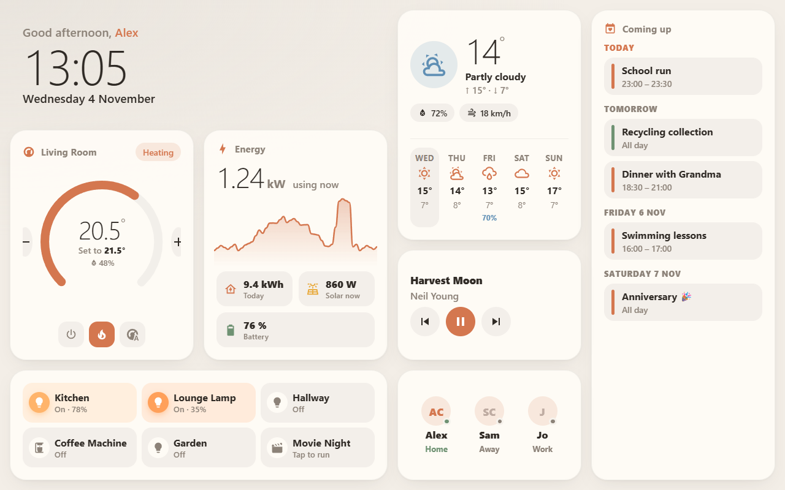
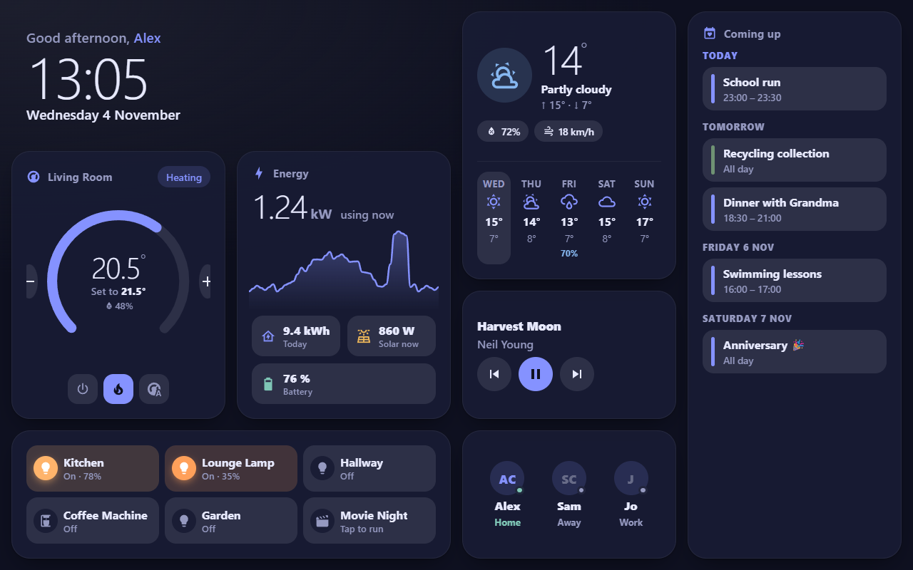
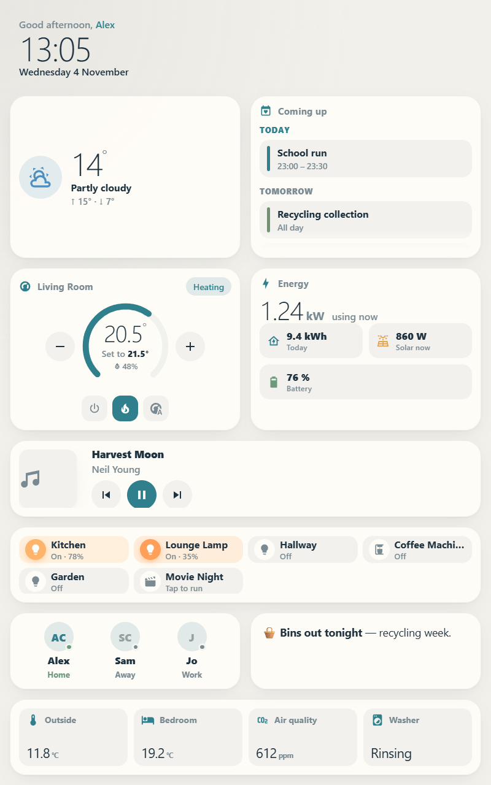

# YAD – Yet Another Dashboard

A warm, modern, **modular widget dashboard** for Home Assistant — built for wall tablets, kitchen displays and kiosks.

One card, in a **panel view**, renders a full-screen grid of widgets that you configure from the visual editor or YAML. It fills the screen (perfect with `?kiosk`), adapts to **portrait or landscape**, and can run as a **display-only** screen with touch disabled.

[](https://hacs.xyz/docs/faq/custom_repositories)
[](https://github.com/therealcarnivor/YAD-Dashboard/releases)



| Midnight indigo, dark mode | Coastal palette, portrait |
| --- | --- |
|  |  |

## Widgets

| Type | What it shows |
| --- | --- |
| `clock` | Time, date and a friendly greeting ("Good morning, Alex") |
| `weather` | Current conditions, high/low, humidity & wind, daily/hourly forecast |
| `calendar` | Agenda with calendar initials/icons, weekend highlighting and optional weekend filtering |
| `energy` | Live power, 24h usage graph, energy today, solar, battery and cost |
| `climate` | Thermostat dial with current/target temperature, +/- and HVAC modes |
| `toggles` | Lights & switches (also fans, scenes, scripts, covers, locks, buttons) |
| `sensors` | Any sensors as tiles or a list |
| `media` | Now playing with artwork and transport controls |
| `people` | Who's home, with avatars and presence |
| `car` | Vehicle charge/fuel, range, location, EV connection/charging and optional extra sensors |
| `spacer` | Quarter-row blank space, horizontal line or dashed divider |
| `card` | **Any existing Home Assistant card** (built-in or custom) embedded as a widget |

## Installation

### HACS (recommended)

1. Open **HACS** in Home Assistant and search for **YAD** in the **Dashboard** category.
2. Open **YAD**, select **Download**, and confirm the installation.
3. Reload your browser, then follow [Setting up the dashboard](#setting-up-the-dashboard).

HACS registers the resource automatically. If it doesn't, add it manually under **Settings → Dashboards → ⋮ → Resources**: URL `/hacsfiles/YAD-Dashboard/yad.js`, type **JavaScript module**. Keep only one YAD resource entry.

### HACS custom repository (alternative)

If YAD is not yet visible in your HACS store, add it as a custom repository:

1. In HACS, open the ⋮ menu → **Custom repositories**.
2. Add `https://github.com/therealcarnivor/YAD-Dashboard` with type **Dashboard**.
3. Search for **YAD**, select **Download**, and reload your browser.
4. Follow [Setting up the dashboard](#setting-up-the-dashboard). The resource URL and updates are the same as for the standard HACS installation above.

### Updates and versions

YAD uses [semantic versioning](https://semver.org/) with [GitHub releases](https://github.com/therealcarnivor/YAD-Dashboard/releases). HACS tells you when a new version is available and shows its release notes. To install an older version, open the repository in HACS and choose **⋮ → Redownload**, then pick the version. See [CHANGELOG.md](CHANGELOG.md) for the full history. The installed version appears at the bottom of the card editor and in the browser console.

### Manual

Copy `dist/yad.js` to `<config>/www/yad.js` and add `/local/yad.js` as a **JavaScript module** resource.

### Troubleshooting a missing card

`Custom element doesn't exist: yad-card` and a missing card-picker entry both mean the browser has not registered the card. Check the script request before reinstalling:

1. Open `/hacsfiles/YAD-Dashboard/yad.js` on **the same Home Assistant address you use for your dashboard**. It must return JavaScript, not a 404 or the Home Assistant login page. Folder names are case-sensitive.
2. If that returns 404 despite `yad.js` existing in `<config>/www/community/YAD-Dashboard/`, try `/local/community/YAD-Dashboard/yad.js` on the same address. Home Assistant serves its `www` folder through `/local`; this checks file serving independently of HACS's `/hacsfiles` endpoint.
   - If `/local/community/YAD-Dashboard/yad.js` returns JavaScript, use that URL as the **JavaScript module** resource temporarily, replacing rather than adding to the `/hacsfiles` entry. Investigate the HACS endpoint and any reverse proxy separately.
   - If both return 404, check that the file is in the running Home Assistant instance's config folder and that your proxy forwards these paths. Changing the card type or reinstalling the bundle cannot fix an HTTP 404.
3. Keep only one resource for YAD. Do not load both the old Hearth bundle and the new bundle, or the same bundle through two different URLs.
4. Reload the dashboard and check the browser console for `YAD 0.3.0` (or the version you installed). If the request succeeds but there is no banner, inspect console errors for a script failure. A 404 alone is not evidence of a cached failure.

## Setting up the dashboard

1. **Settings → Dashboards → Add dashboard** → *New dashboard from scratch*.
2. Open it, choose **Edit dashboard**, then edit the view and set **View type** to **Panel (single card)**.
3. Add a card and pick **YAD – Yet Another Dashboard** (or use a *Manual* card with `type: custom:yad-card`).
4. Configure the look and add widgets in the visual editor.
5. Open the dashboard with `?kiosk` on the URL (e.g. `/dashboard-home/0?kiosk`) for a full-screen display. YAD fills the viewport by default (`height: screen`).

> `?kiosk` requires a kiosk add-on such as [kiosk-mode](https://github.com/NemesisRE/kiosk-mode). Without kiosk mode, set `height: calc(100vh - 56px)` so the grid accounts for the HA header.

## Configuration

### Dashboard options

| Option | Default | Description |
| --- | --- | --- |
| `layout_mode` | `grid` | `grid` keeps row-based/fill-screen sizing; `compact` packs widgets vertically with optional per-widget automatic height |
| `theme` | `auto` | Light/dark mode: `auto` (follows HA light/dark), `light`, `dark`, or `ha` to use your HA theme colours instead of a palette |
| `palette` | `hearth` | Colour palette (each has a light and dark variant): `hearth`, `scandi`, `nordic`, `cottage`, `coastal`, `lavender`, `rose`, `urban`, `indigo`, or `custom` |
| `custom_palette` | – | Your own colours when `palette: custom` — see [Colour palettes](#colour-palettes) |
| `accent_color` | palette | Override the accent colour of any palette, e.g. `"#7c9a7e"` |
| `background` | – | Optional background image URL (tiles become frosted glass) |
| `background_media` | – | HA media selector value (`media_content_id`, optional `media_content_type`); use the editor to browse media or upload an image |
| `background_opacity` | `100` | Image opacity, 0–100%; widgets are not faded |
| `background_blur` | `0` | Image blur in px (0–30) |
| `background_fit` | `cover` | `cover` fills the screen; `contain` shows the whole image |
| `background_position` | `center` | Image alignment (`center`, `top`, `bottom`, `left`, `right`) |
| `orientation` | `auto` | `auto` (detects screen orientation), `landscape` or `portrait` |
| `screen` | `fill` | `fill` uses the available space, or lay out for a fixed resolution: `720p`, `1080p`, `1440p`, `4k`, `wsvga` (1024×600), `wxga` (1280×800), `wuxga` (1920×1200), `ipad` (2048×1536), or `custom` — see [Screen sizes](#screen-sizes) |
| `screen_width` / `screen_height` | – | Resolution in px when `screen: custom` |
| `ui_scale` | `auto` | UI scale for fixed screens, like OS display scaling (`1`, `1.5`, `2`…) |
| `columns` | `4` | Grid columns in landscape |
| `portrait_columns` | `2` | Grid columns in portrait |
| `height` | `screen` | When `screen: fill`: `screen` fills the viewport with rows sized to fit; `auto` uses fixed `row_height` rows; or any CSS height |
| `row_height` | `180` | Row height in px when `height: auto` |
| `gap` | `16` | Spacing between tiles in px |
| `display_only` | `false` | Disable all touch/clicks and hide controls — a pure information display |
| `hide_cursor` | `false` | Hide the mouse cursor (useful for kiosk PCs) |
| `widgets` | – | List of widgets (below) |

### Options shared by every widget

| Option | Description |
| --- | --- |
| `type` | Widget type (see table above) |
| `title` | Optional title for the widget |
| `col_span` / `row_span` | Size in grid cells (landscape) |
| `portrait_col_span` / `portrait_row_span` | Size override for portrait |
| `visibility` | `all` (default), `landscape` or `portrait` |
| `transparent` | Render without the tile background (default for `clock`) |
| `auto_height` | `false` by default. In compact mode, shrink to content instead of using row spans; ignored in grid mode and for spacers |
| `auto_height_max` | Maximum total tile height in px for automatic sizing (default `600`, minimum `60`); long lists scroll within this limit |

Widgets are packed into the grid in order, filling gaps automatically.

### Compact layout

Select **Screen & layout → Dashboard layout → Compact**. Open a widget's **Size & placement** and enable **Automatic height** to remove unused vertical space. Set **Maximum automatic height** to limit long calendars, sensor lists or embedded cards. Leave automatic height off on widgets you want to keep at their row-based size.

Compact layout grows with content and scrolls instead of stretching widgets to fill the screen. It ignores `screen`, `ui_scale` and `height` while selected; switching back to **Fixed grid** restores those settings. Width and portrait width overrides still apply, and changing content or available width repacks the tiles. Dense packing can place later widgets in an earlier gap, while the keyboard/DOM order remains your configured widget order. Spacers keep their explicit quarter-row size.

```yaml
type: custom:yad-card
layout_mode: compact
columns: 4
portrait_columns: 2
row_height: 180
widgets:
  - type: car
    charge_entity: sensor.car_battery
    auto_height: true
    col_span: 2
  - type: calendar
    entities:
      - calendar.family
    auto_height: true
    auto_height_max: 360
    col_span: 1
  - type: climate
    entity: climate.living_room
    row_span: 2
```

### Widget options

**clock** — `greeting` (true), `greet_by_name` (true; set `false` for just "Good morning"), `name` (defaults to the HA user's first name), `show_date` (true), `show_seconds` (false), `time_format` (`auto`, `12`, `24`).

**weather** — `entity` (required), `forecast_type` (`daily`, `hourly`, `twice_daily`), `forecast_count` (5), `show_details` (true).

**calendar** — `entities` (list of calendars; use `{ entity: calendar.x, name: "Family", icon: "mdi:home", color: "#hex" }` for overrides), `days` (7), `max_events` (8), `show_location` (false), `refresh_minutes` (5). `show_weekends` (true) controls whether Saturday/Sunday events appear; `highlight_weekends` (false) makes weekend headings and events distinct. Filtering runs before `max_events`. `show_calendar_badge` (true) shows the calendar's first initial inside a wider colour bar, or your configured icon. Set it to false to retain the narrow bar. Ongoing multi-day events remain visible on their first eligible weekday when weekends are hidden.

**energy** — `power_entity` (current consumption in W or kW), `today_entity`, `solar_power_entity`, `solar_today_entity`, `battery_entity`, `cost_entity`, `show_graph` (true), `hours_to_show` (24). All optional — show only what you have.

**climate** — `entity` (required), `name`, `show_modes` (true), `humidity_entity`.

**toggles** — `entities` (strings or `{ entity, name, icon }`), `min_tile_width` (150). Tap to toggle, long-press for more info.

**sensors** — `entities` (strings or `{ entity, name, icon, color }`), `layout` (`grid` or `list`), `min_tile_width` (140).

**media** — `entity` (required), `name`, `show_volume` (false).

**people** — `entities` (person entities), `show_state` (true).

**card** — `card`: any Lovelace card configuration.

**car** — `title`, `charge_entity` and `fuel_entity` (percentage sensors), `range_entity` (sensor), `location_entity` (device tracker), `plugged_in_entity` and `charging_entity` (binary sensors or sensors). Add extra vehicle data with `entities` (strings or `{ entity, name, icon }`). Each field is optional; unconfigured, missing, unknown and unavailable entities are omitted, but valid zero values and off states remain visible. Tap a reading for more info unless display-only mode is enabled.

**spacer** — `style` (`blank`, `line`, `dashed`), optional `line_color`, `row_span` (0.25 by default; 0.25, 0.5, 0.75 or 1), and `portrait_row_span` with the same choices. The default is transparent and full-width (up to four columns). Other widgets keep whole-row heights. A spacer switches the visible grid to quarter-row tracks: four tracks **including their internal spacing** equal a normal row. With `height: auto`, `row_height: 180` and `gap: 0`, a quarter spacer is 45px; with the default 16px gap it is 33px and a normal row stays 180px. Extremely large vertical gaps are reduced if needed to keep quarter tracks positive. Filled-screen and fixed-screen modes scale tracks to the available height. Dense packing still applies; use a spacer spanning all your columns to reserve a whole horizontal strip.

### Background images

In the editor's **Background image** section, use the native HA image picker to browse media or upload a file. Uploading requires a user with permission to upload images. You can still enter an ordinary image URL instead; changing the media selection clears the URL, and entering a URL clears the media selection. Opacity affects only the image, not the dashboard's text or widgets. Media-source URLs are resolved at runtime and renewed on long-running displays; access and load errors are shown on the dashboard.

The **Colour palette** section is collapsed initially. Expand it to select a palette, customise colours or change the accent.

```yaml
background_media:
  media_content_id: media-source://media_source/local/wallpaper.jpg
  media_content_type: image/jpeg
background_opacity: 40
background_blur: 2
background_fit: cover
```

Use the picker to obtain the correct media ID for your installation.

### Vehicle and divider example

```yaml
widgets:
  - type: car
    title: Family car
    charge_entity: sensor.car_battery
    range_entity: sensor.car_range
    location_entity: device_tracker.car
    plugged_in_entity: binary_sensor.car_plugged_in
    charging_entity: binary_sensor.car_charging
    col_span: 2
    row_span: 2
  - type: spacer
    style: line
    col_span: 4
    row_span: 0.25
    portrait_row_span: 0.5
```

### Example

```yaml
type: custom:yad-card
theme: auto
columns: 4
portrait_columns: 2
widgets:
  - type: clock
    col_span: 2
  - type: weather
    entity: weather.home
    row_span: 2
  - type: calendar
    entities:
      - calendar.family
      - entity: calendar.bin_collection
        color: "#6f9273"
    row_span: 4
    portrait_row_span: 2
  - type: climate
    entity: climate.living_room
    row_span: 2
  - type: energy
    power_entity: sensor.house_power
    today_entity: sensor.energy_today
    solar_power_entity: sensor.solar_power
    battery_entity: sensor.battery_level
    row_span: 2
  - type: media
    entity: media_player.kitchen
    portrait_col_span: 2
  - type: toggles
    title: Lights
    col_span: 2
    entities:
      - light.kitchen
      - light.lounge_lamp
      - switch.coffee_machine
      - entity: scene.movie_night
        icon: mdi:movie-open
  - type: people
    entities: [person.alex, person.sam]
  - type: sensors
    title: Around the house
    col_span: 2
    visibility: portrait
    entities: [sensor.outdoor_temperature, sensor.bedroom_temperature]
  - type: card
    card:
      type: markdown
      content: "🧺 Bins go out on **Thursday**"
```

### Screen sizes

Pick the resolution of the display the dashboard is for (`screen: 1080p`, `screen: 4k`, …) and set `orientation: portrait` or `landscape`. YAD lays the grid out for exactly that screen and scales it to fit whatever it's viewed on — so the editor preview on your laptop matches the wall tablet pixel for pixel, letterboxed in the palette colours.

High-resolution panels get a matching UI scale automatically (like Windows/macOS display scaling): a 4K screen lays out like 1080p but renders twice as sharp, 1440p uses 150%. Override with `ui_scale` if text looks too big or small. Use `screen: custom` with `screen_width`/`screen_height` for anything else.

### Colour palettes

Choose a palette in the editor's gallery — every palette comes in light and dark, and `theme: auto` switches between them with Home Assistant. With `palette: custom`, pick your own colours using the colour wheel; anything you leave empty falls back to the Hearth palette:

```yaml
palette: custom
custom_palette:
  light:
    background: "#eef3ef"
    surface: "#ffffff"   # tiles
    text: "#1f2d26"
    accent: "#0f766e"
    success: "#4f8a6a"   # on / home
    warm: "#e3a24b"      # lights & heating
    info: "#4f8fbf"      # cooling, rain, solar
  dark:
    accent: "#f59e0b"
```

### Display-only mode

Set `display_only: true` for a screen nobody should touch (hallway clock, TV, picture frame). All interaction is disabled, controls such as thermostat buttons and media controls are hidden, and only state is shown. Combine with `hide_cursor: true` on a PC-based kiosk.

## Development

```bash
npm install
npm run build      # -> dist/yad.js
npm run watch      # rebuild on change
npm run typecheck
npx playwright install chromium # once, for browser tests
npm test           # production bundle smoke tests
npm run demo       # builds demo/build/demo.js with a mocked Home Assistant
npx http-server .  # then open http://localhost:8080/demo/
```

The demo page accepts `?dark=1`, `?theme=light|dark|ha`, `?palette=<name>|custom`, `?screen=1080p|4k|…`, `?orientation=portrait|landscape`, `?greet=0`, `?display_only=1`, `?showcase=1` (vehicle, divider and weekend highlighting) and `?layout=compact` (automatic widget heights).

`dist/yad.js` is committed so HACS can install straight from the repository, and each GitHub release also includes it as a download.

CI checks HACS compliance, version consistency, TypeScript, bundle reproducibility and production-bundle loading in Chromium. Releases are blocked if HACS validation or browser tests fail. Browser tests use a mocked Home Assistant object; they do not certify every widget against a live Home Assistant installation.

### Maintaining HACS compliance

YAD is a **Dashboard/plugin**, not a backend integration; Hassfest and integration-brand requirements do not apply. Follow the [HACS inclusion requirements](https://hacs.xyz/docs/publish/include/): keep the repository public and active, with issues enabled, a description, topics, an identifiable open-source license and README images. HACS validation must pass without ignored checks, and a full GitHub release must be published after successful validation.

### Releasing a new version

1. As you work, add entries under **Unreleased** in [CHANGELOG.md](CHANGELOG.md).
2. Cut the release in one of two ways:
   - **From your PC:** `npm version patch` (bug fixes), `npm version minor` (new features) or `npm version major` (breaking changes). This bumps `package.json`, syncs `src/version.ts`, moves the Unreleased notes under the new version, rebuilds `dist`, commits "Release vX.Y.Z", tags it and pushes.
   - **From GitHub:** **Actions → Release → Run workflow**, pick the bump type and run it. The workflow does the same steps.
3. The [Release workflow](.github/workflows/release.yml) builds the card, checks the tag matches `package.json`, and publishes a GitHub release with the changelog notes and `yad.js` attached. HACS then offers it as an update.

Versions with a suffix (for example `npm version prerelease --preid beta` → `1.2.0-beta.0`) are published as pre-releases, which HACS only shows to people who opt in to beta versions.

## License

MIT
